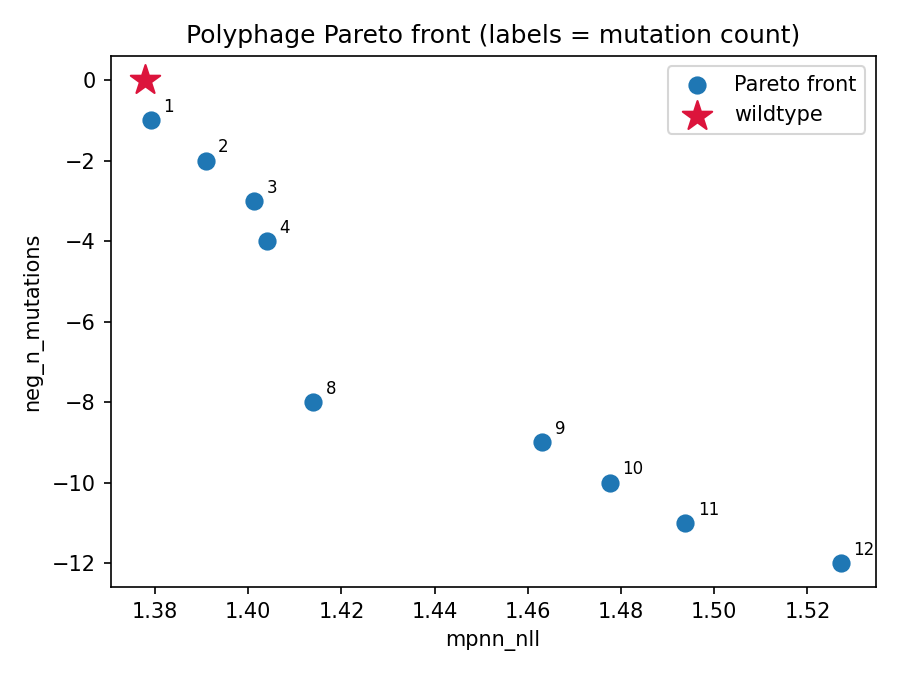

# Polyphage

[](https://colab.research.google.com/github/Sym-jay/polyphage/blob/main/Polyphage.ipynb)

Multi-objective computational design of *Ideonella sakaiensis* PETase
(IsPETase) variants for PET-plastic degradation.

ProteinMPNN proposes sequences against a fixed backbone with the catalytic triad
frozen; ThermoMPNN predicts the stability cost of each mutation; NSGA-II searches
that space under competing objectives and returns a Pareto front rather than a
single "best" sequence.

The problem being targeted: wild-type IsPETase denatures around 46–48 °C, but PET
only becomes accessible to enzymes near its glass transition at 65–70 °C. The
natural enzyme falls apart before the plastic is soft enough to chew.

## Results so far

A 1000-candidate run (run 2: 40 individuals × 25 generations, 142 s on a T4)
produced:

```
n_mut=9   mpnn_nll=1.3151   N37Q R53S T77K K95A T116A T140D Q228A R260F H293V
n_mut=10  mpnn_nll=1.3303   N37Q R53S T77K K95A T116A Q228A R260F T270N S290A H293I
```

Both score better than wild-type (1.3783) under ProteinMPNN, and the first
contains **T140D** — position 140, threonine to aspartate — one of the ten
mutations in [DuraPETase](https://doi.org/10.1038/s41467-021-27136-4)
(Cui et al. 2021), an experimentally validated heat-stable PETase. The search
had no access to that paper; it recovered the mutation from structure alone.

**None of this is a validated claim yet.** Four caveats, in order of severity:

1. **The run predates the reproducibility fix.** Until commit
   `fix/reproducibility-and-thermompnn`, the optimizer's operators drew from OS
   entropy rather than the run seed, so *this specific front cannot be
   regenerated*. It must be re-run before it is reported anywhere.
2. **The front has two members that share seven mutations** — one converged
   lineage plus a neighbour, not two independent discoveries. The effective
   sample size behind T140D is **1**.
3. **Position-level overlap is near-worthless evidence.** With 14 known hotspot
   positions among 262 mutable ones, a 9-mutation variant hits *some* hotspot
   39% of the time by chance (simulated). Only the exact position-and-residue
   match carries signal: ~2.5% by chance, which makes T140D suggestive at best
   from a single observation.
4. **The randomization control has still not been run.** `polyphage/control.py`
   measures both numbers against an explicit null. Treat T140D as a lead until
   that output exists.



**Note the figure is from run 1, not run 2** — the 7.3 s smoke test (12
individuals × 5 generations). Every point on it is worse than wild-type on both
axes and the front is nearly a straight line, which by this project's own
criterion means the two objectives are not in genuine conflict. It is kept as an
illustration of that failure mode, not as a result. Regenerate it from run 2
before using it anywhere.

Full run log: [`results/runs.jsonl`](results/runs.jsonl).

## Status

| Component | State |
|---|---|
| Residue mapping + triad gate | Working, gated, tested |
| ProteinMPNN batch scorer | Working, checked against the reference path |
| NSGA-II search | Working; **reproducible as of this branch** |
| Randomization control (uniform) | Implemented, **never run** |
| Randomization control (model prior) | Implemented, **never run** |
| Replication across seeds | Implemented, **never run** |
| ThermoMPNN ddG | Fixed on this branch, **not yet re-run end to end** |
| Activity / docking screen | Not started |
| Wet-lab validation | Not started |

Run the tests with `python -m pytest tests/ -q`. They need neither a GPU nor
ProteinMPNN: both the target and the scoring model are synthetic, because what
is under test is the search's RNG plumbing and the ddG residue mapping.

## Reference structures

| What | PDB | Note |
|---|---|---|
| Wild-type IsPETase | `6EQE` | 0.92 Å, Austin et al. 2018 PNAS. The design target. |
| Wild-type IsPETase (apo) | `5YFE` | 1.39 Å alternative |
| Wild-type + MHET analog | `5XG0` | 1.58 Å, for later docking validation |
| FAST-PETase | `7SH6` | Lu et al. 2022 Nature. Benchmark only, not a design input. |

Catalytic triad: **Ser160** (nucleophile), **His237** (general base),
**Asp206** (orients His237). Frozen in every design.

Earlier notes in this project cited `6EQM` and `7VVE`. Both were wrong —
`7VVE` is not FAST-PETase at all. Use the table above.

## Layout

```
polyphage/
  encoding.py    vector <-> sequence <-> PDB residue numbers; triad gate
  scoring.py     ProteinMPNN foldability; batched + subprocess reference
  optimize.py    NSGA-II problem, categorical operators, objective specs
  validate.py    hotspot overlap, front reporting, run log, plotting
  control.py     randomization controls: uniform and ProteinMPNN-prior nulls
  replicate.py   recovery rate across seeds, with CIs and Holm correction
  stability.py   ThermoMPNN ddG via a cached site-saturation table
tests/             regression tests, 33 of them, none needing a GPU
build_notebook.py  generates Polyphage.ipynb
results/           run log and figures
```

**`Polyphage.ipynb` is generated.** Edit the modules, then run
`python3 build_notebook.py` to regenerate it. Hand-edits to the notebook are
discarded by the next build. Never commit a notebook downloaded from Colab —
it carries embedded outputs that make diffs unreadable.

## Usage

Click the Colab badge above, set Runtime → T4 GPU, and run top to bottom.
Cells 4 and 6 are gates: if either raises, stop rather than continuing, because
everything downstream depends on the residue mapping being correct.

Locally:

```python
from polyphage import *

target = load_target("inputs/design_target/6EQE.pdb", "outputs/parsed_6EQE.jsonl")
batch  = BatchScorer(mpnn_dir=".", pdb_path="inputs/design_target/6EQE.pdb")

objectives = [foldability_objective(batch), novelty_objective(target)]
res = run(target, objectives, pop_size=40, n_gen=25, max_mutations=10)
print_front(report_front(target, res, [o.name for o in objectives]))
```

## Design decisions

**Categorical operators, not continuous ones.** Amino acid identity is
categorical. pymoo's default SBX crossover and polynomial mutation assume an
ordered continuous variable, under which "index 5 (F) lies between 4 (E) and
6 (G)" — biochemically meaningless, and it biases the search toward the middle of
the alphabet. `optimize.py` uses uniform crossover and random-reset mutation.

**Mutations can revert.** Without reversion, mutation count only ratchets upward
and the low-mutation end of the front collapses — exactly the end that matters,
since FAST-PETase is 5 mutations.

**Scores are averaged over fixed decoding orders.** ProteinMPNN scores a sequence
under a random autoregressive decoding order, with a spread of ~0.02 nats on this
protein — comparable to the score change from one or two mutations. Averaging over
8 fixed-seed orders makes the objective deterministic and cuts that noise.
Otherwise NSGA-II ranks candidates by dice.

**Stability lookups, not model calls.** ThermoMPNN's site-saturation scan runs
once on the wild-type and is cached as a table, so scoring a variant inside the
loop is a handful of lookups.

**The seed has to actually reach the operators.** pymoo passes operators a
seeded generator under `random_state`; it has never passed one under `seed`.
Reading `kwargs.get("seed")` returned `None`, `np.random.default_rng(None)` then
drew from OS entropy, and every run was irreproducible while still recording
`"seed": 1` in the log. `tests/test_reproducibility.py` fails if this regresses.

## Two bugs worth knowing about

Both were live in the code that produced the results above, and both were the
kind that fail quietly rather than loudly.

**Irreproducible runs.** Described just above. Consequence: no previously logged
run can be regenerated, and `repeat_seeds_summary` was not varying what its name
claims. Fixed on this branch.

**ThermoMPNN residue numbering.** ThermoMPNN's SSM output indexes positions
0-based along the sequence; the design target uses PDB numbering, which on 6EQE
starts at residue 29. Reading one as the other shifted every ddG by 29 residues
— and because ~89% of positions still overlapped numerically, the coverage check
passed. The parser now maps through `target.residue_numbers` and verifies the
wildtype letter on every row, so a mismatch raises instead of silently poisoning
the objective. Any ddG number produced before this fix should be discarded.

A related trap, not a bug but worth stating: nothing in the pipeline would
notice if ThermoMPNN's ddG sign were inverted — the optimizer would simply
minimize toward the *least* stable variants. `StabilityOracle.check_sign_convention()`
tests the sign against the known heat-stable mutations and should be run before
any three-objective search.

## What a reportable claim looks like

A single run recovering T140D is an anecdote. The reportable form is:

> The method recovers T140D in k of n independent runs (95% CI [lo, hi]),
> against a chance rate of p per run.

`replicate.py` produces exactly that table. Three things make it defensible:

**Confidence intervals, Wilson not normal.** With 20–50 seeds and counts often
at 0 or n, the normal approximation produces intervals outside [0, 1]. Wilson
does not.

**Correction for multiple testing.** There are 14 known mutations to recover.
Testing each and reporting the smallest p-value is cheating; `holm_adjust`
controls the family-wise error rate without assuming the tests are independent,
which they are not — mutations co-occur within a variant.

**Two nulls, not one.**

| Null | Question it answers |
|---|---|
| Uniform random mutation | Did the search beat chance? |
| ProteinMPNN's own prior | Did the *optimizer* find it, or did the model's prior already favour it? |

The second is the one a reviewer reaches for. It samples replacement residues
from the model's conditional distribution at each position while keeping
position choice uniform, so a mutation that survives it was located by the
search rather than handed over by the prior. A mutation significant under the
uniform null but not the strict one should be reported as such.

`replicate.py` also reports **front diversity** — mean pairwise Hamming distance
within a Pareto front. This project's run 2 returned two variants sharing seven
of nine mutations: one converged lineage presented as two findings. The metric
makes that visible instead of leaving it to be noticed by eye.

## Limitations

Stated plainly, because they bound what this project can claim:

- **No wet-lab validation.** This produces ranked candidates, not verified enzymes.
- **ProteinMPNN's score measures foldability, not function.** Nothing in the
  current objectives measures catalysis. These variants are not shown to degrade
  PET faster, or at all.
- **ddG is additive here.** ThermoMPNN is trained on single point mutants; summing
  per-mutation ddG across a 9-mutation variant ignores epistasis and generally
  overestimates stabilisation. It is a screening heuristic for ranking, not a
  ground truth.
- **Stability and activity can trade off.** Rigidifying a protein can stiffen the
  active site it needs for chemistry.
- **Beating wild-type on ProteinMPNN NLL is expected, not a finding.** Natural
  enzymes sit off the inverse-folding optimum because evolution trades stability
  against function and regulation. A lower NLL than wild-type is a known
  property of these models, so it cannot carry a result on its own.
- **`novelty_objective` is not a real objective.** Maximising mutation count is
  not a property anyone wants in an enzyme; it exists to give the front a second
  axis. Until ddG or activity replaces it, the two-objective front is closer to
  a diversity sweep than a trade-off.

## Roadmap

1. **Re-run everything under the reproducibility fix.** No pre-fix number is
   citable. This gates all of the below.
2. Randomization control on the T140D finding — gates whether it can be claimed.
3. Replication: 20–50 independent seeds at the run-2 configuration, reporting
   recovery rate per known mutation with confidence intervals, rather than one
   anecdote. `replicate.replicate` produces the table; budget ~2.5 min per seed
   on a T4.
4. Both nulls on the replicated result — uniform and ProteinMPNN-prior.
5. Three-objective runs: foldability + ddG + mutation count, after
   `check_sign_convention()` passes.
6. Activity screen on top candidates: ESMFold → triad geometry check → PET
   oligomer docking (AutoDock Vina / GNINA), measuring Ser160 OG to ester
   carbonyl distance. This is the part that speaks to actual plastic degradation.
7. FastAPI + Docker serving layer, so other researchers can supply their own
   constraints and get ranked sequences back.

## How this was built

The pipeline was developed with AI assistance (Claude Code, Anthropic). That
covered module design and implementation, the ProteinMPNN and NSGA-II
integration, the batched scoring path, and the validation tooling. Commits carry
a `Co-Authored-By: Claude Opus 5.5` trailer.

The scientific direction, the choice of objectives, the structures, and the
interpretation of results are the author's. Several factual errors introduced
early on — notably the wrong PDB accession codes — were caught by verifying
identifiers against RCSB and the primary literature rather than trusting
generated text. That verification step is part of the method, not an aside.

## References

- Austin et al. 2018, *PNAS* — IsPETase structure, 6EQE
- Lu et al. 2022, *Nature* — FAST-PETase (S121E/D186H/R224Q/N233K/R280A), 7SH6
- Cui et al. 2021, *Nature Communications* — DuraPETase
- Dauparas et al. 2022, *Science* — [ProteinMPNN](https://github.com/dauparas/ProteinMPNN)
- Dieckhaus et al. 2024, *PNAS* — [ThermoMPNN](https://github.com/Kuhlman-Lab/ThermoMPNN)
- Deb et al. 2002, *IEEE Trans. Evol. Comput.* — NSGA-II
